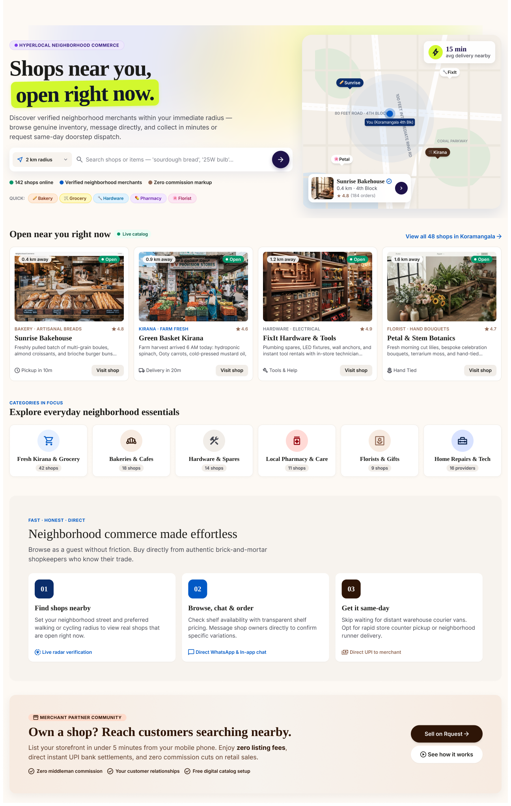

# Rquest — hyper-local marketplace & directory

> "Connect Everywhere Everything" — a web platform that connects physical retail merchants with nearby local customers, built as a single full-stack monorepo.



## What it does

- **Proximity search & store discovery** — customers search for goods and shops within a geographic radius using live GPS coordinates and geospatial queries (PostgreSQL `earthdistance` + `cube`).
- **Real-time consumer ↔ merchant messaging** — customers chat directly with shop owners over Socket.IO before visiting in person.
- **Merchant onboarding & shop management** — store owners register outlets, drop location pins on interactive Leaflet maps, assign categories and maintain contact info.
- **Admin taxonomy & catalog** — back-office management of a hierarchical `Category → SubCategory → Products` tree, with bulk GPS/Excel import tooling.

## Stack

| Layer | Tech |
|---|---|
| Frontend | React 17 + Vite 5, Ant Design 5, Leaflet / react-leaflet, Zustand, React Router v5 (PWA manifest) |
| Backend | Node.js, Express 4 (REST under `/api/v1`), Socket.IO 4 |
| Database | PostgreSQL + Sequelize 6 (migrations, seeders), `earthdistance` extension for geo queries |
| Auth | Stateless JWT (Bearer header) + bcrypt, `PrivateRoute` guards on the client |
| Storage / Geo data | AWS S3 for uploads, OpenCage for geocoding / reverse geocoding |

## Architecture

```
Browser (PWA) ──HTTP──► Vite/React client
              ──WS────► Socket.IO server
                          │
              REST /api/v1│
                          ▼
                 Express API server
        ┌────────────┼──────────────┐
   PostgreSQL   AWS S3       OpenCage API
 (earthdistance) (uploads)   (geocoding)
```

Monorepo layout:

```
src/
├── server.js          # Express HTTP + Socket.IO entry point
├── api/               # Backend: auth, config, migrations, models, routes, seeders
├── app/               # Frontend core: components (maps, chat, shop cards), routes, Zustand stores
└── screens/           # Views: Home, Login, Register, ClientRegister, Admin
py.sh                  # Utility script for parsing Excel / Google Maps GPS data
```

## Running locally

```bash
npm install

# configure the API (DB URL, JWT secret, S3, OpenCage keys)
cp src/api/.gitignore .env 2>/dev/null || true   # see src/api/config/config.js for required vars

npm run dev        # Vite HMR client + Nodemon API
```

Requirements: Node.js, PostgreSQL with the `cube` and `earthdistance` extensions enabled.

## Notes

- All REST routes are prefixed `/api/v1`; geospatial distance uses the `<@>` point operator (statute miles).
- Real-time events use `message_received`, with a server-side `socketData` map of connected users.
