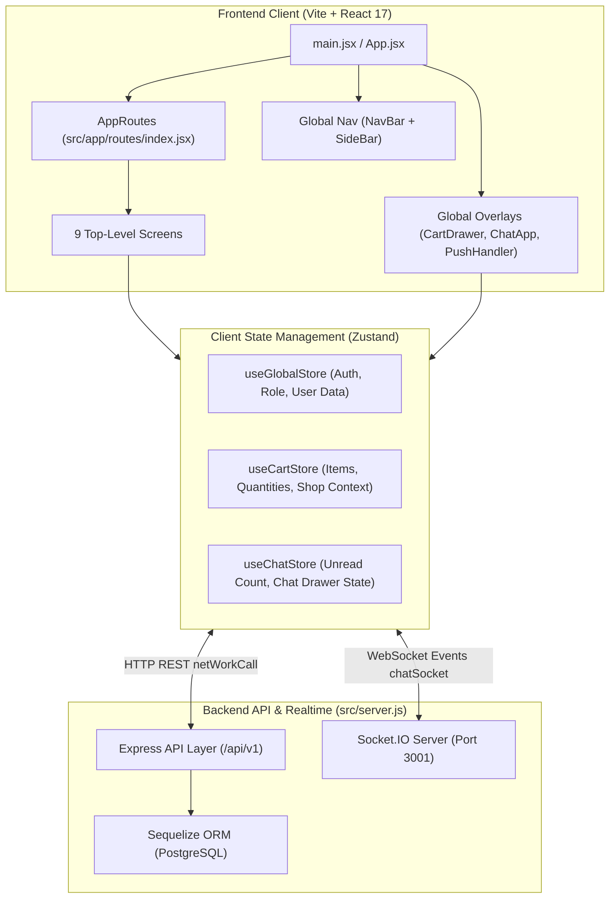
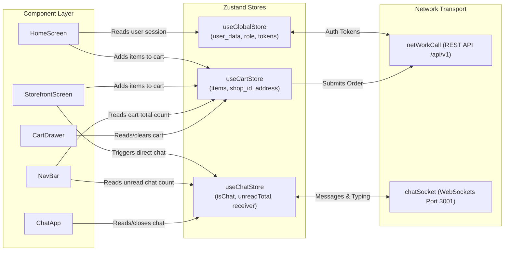

# Rquest — Complete Screen & Component Tree Architecture

> Comprehensive visualization and technical reference for all screens, UI components, state stores, and data flows across the Rquest codebase.

---

## 1. High-Level System Architecture & Layering

The application is structured as a full-stack monorepo featuring a **Vite + React 17 SPA** client and an **Express 4 + Sequelize ORM** backend over PostgreSQL.



---

## 2. Complete Screen & Component Tree

Below is the end-to-end component hierarchy starting from the DOM root down to individual UI widgets.

```mermaid
graph TD
    Root["App.jsx (AntD ConfigProvider + App)"]
    Router["AppRoutes (src/app/routes/index.jsx)"]
    
    Root --> Router
    Router --> RouteHandler["RouteChangeHandler (Closes chat on navigation)"]
    Router --> PushHandler["PushNotificationHandler (Web push & real-time toasts)"]
    Router --> NavBar["NavBar (Desktop menu, notifications, user capsule)"]
    Router --> SideBar["SideBar (Mobile drawer, quick navigation)"]
    Router --> CartDrawer["CartDrawer (Slide-over cart, checkout, address picker)"]
    Router --> ChatApp["ChatApp (Floating direct socket messenger)"]
    
    Router --> Switch["React Router Switch"]
    
    Switch --> Home["HomeScreen ('/')"]
    Switch --> Login["LoginScreen ('/login')"]
    Switch --> Register["RegisterScreen ('/register')"]
    Switch --> Storefront["StorefrontScreen ('/shop/:shop_id')"]
    Switch --> Orders["OrdersScreen ('/orders') [Private]"]
    Switch --> Profile["ProfileScreen ('/profile') [Private]"]
    Switch --> Delivery["DeliveryPortalScreen ('/delivery-portal') [Private]"]
    Switch --> ClientReg["ClientRegister ('/client_register') [Private]"]
    Switch --> Admin["AdminScreen ('/admin') [Private]"]

    %% Home Subcomponents
    Home --> LeafletMap["LeafletComponent (Interactive map + GPS pin)"]
    Home --> SearchFilter["SearchFilterBar (Radius, categories, sorting)"]
    Home --> ShopCard["ShopCard (Store grid card with distance & rating)"]
    Home --> ShopTable["ShopTableView (Tabular comparison mode)"]
    Home --> VoiceSearch["VoiceSearchModal (Speech-to-text input)"]
    Home --> ImageSearch["ImageSearchModal (Camera/upload recognition)"]
    Home --> AiSearch["AiSearchModal (Natural language intent extractor)"]
    Home --> AddressModal["AddressModal (Delivery/search coordinate selector)"]

    %% Storefront Subcomponents
    Storefront --> CatalogGrid["Product Cards Grid (Section tabs, veg/non-veg filter)"]
    Storefront --> DirectChatTrigger["Chat Direct Trigger (Opens ChatApp)"]
    Storefront --> AddToCartModal["Product Quantity & Note Controls"]

    %% Client / Merchant Register Subcomponents
    ClientReg --> ManageStore["ManageStore (Catalog builder, store settings)"]
    ManageStore --> AddProductModal["AddProductModal (Single product addition)"]
    ManageStore --> ImportCsvModal["ImportProductCsvModal (Bulk catalog upload)"]
    ManageStore --> StoreMap["LeafletComponent (Storefront coordinate pin)"]

    %% Orders Subcomponents
    Orders --> Stepper["Order Status Stepper (Pending, Confirmed, Out for Delivery, Delivered)"]
    Orders --> PinLock["Counter PIN Verification (4-digit security code)"]
    Orders --> AdminOrdersAccounts["AdminOrdersAccounts (Embedded merchant ledger)"]

    %% Profile Subcomponents
    Profile --> AddressCard["AddressCard (Saved home/work addresses)"]
    Profile --> ProfileAddrModal["AddressModal (Leaflet coordinate picker)"]
    Profile --> OnboardingSheet["Onboarding Flow (Preferences & role activation)"]

    %% Admin Subcomponents
    Admin --> AdminCategory["Category (Taxonomy & standard form schemas)"]
    Admin --> AdminShops["ShopsManager (Custom schema overrides)"]
    Admin --> AdminAccounts["orders_accounts (Platform order ledger & export)"]
    AdminCategory --> SchemaBuilder["FormSchemaBuilder (Dynamic custom field builder)"]
    AdminShops --> SchemaBuilder
```



---

## 3. Screen-by-Screen Deep Dive

### 3.1 [`HomeScreen`](file:///home/dev/Freelance/rquest/src/screens/home/index.jsx) (Root `/`)
* **Purpose**: Primary marketplace discovery engine. Allows customers to find nearby kirana stores, supermarkets, restaurants, and technicians using live GPS proximity queries.
* **Key State**:
  * `markerLocation`, `position`: User's active GPS coordinate `[lat, lng]`.
  * `searchMode`: `'items'` (product/service search) vs `'shops'` (store search).
  * `viewMode`: `'grid'` (tactile visual cards) vs `'list'` (dense tabular comparison).
  * `filters`: Category IDs, max distance (1–50 km), max price, operational status (`onlyAvailable`).
* **Sub-Components**:
  * [`LeafletComponent`](file:///home/dev/Freelance/rquest/src/app/components/leaflet/leaflet.jsx): Interactive OpenStreetMap with color-coded store markers and draggable location pins.
  * [`SearchFilterBar`](file:///home/dev/Freelance/rquest/src/app/components/filters/SearchFilterBar.jsx): Sticky filter ribbon with quick-category tags and distance sliders.
  * [`ShopCard`](file:///home/dev/Freelance/rquest/src/app/components/cards/shopcards.jsx): Store preview card showing open status, distance in meters/km, and delivery availability.
  * [`ShopTableView`](file:///home/dev/Freelance/rquest/src/app/components/cards/ShopTableView.jsx): High-density Ant Design data table for quick comparative pricing.
  * [`VoiceSearchModal`](file:///home/dev/Freelance/rquest/src/app/components/search/VoiceSearchModal.jsx), [`ImageSearchModal`](file:///home/dev/Freelance/rquest/src/app/components/search/ImageSearchModal.jsx), [`AiSearchModal`](file:///home/dev/Freelance/rquest/src/app/components/search/AiSearchModal.jsx).
* **API Calls**:
  * `POST /api/v1/shops/search` — Geospatial proximity query via PostgreSQL `earthdistance`.
  * `POST /api/v1/listings/search` — Direct item and product catalog search.
  * `GET /api/v1/user/addresses` — Fetch logged-in user's saved locations.

---

### 3.2 [`StorefrontScreen`](file:///home/dev/Freelance/rquest/src/screens/storefront/index.jsx) (`/shop/:shop_id`)
* **Purpose**: Public-facing merchant storefront. Customers browse product sections, view merchant operating hours, and add items directly to their cart.
* **Key State**:
  * `shop`: Store details (banner, address, ratings, phone, operational status).
  * `listings`: Array of product items categorized by aisle/section.
  * `activeTab`: Selected product category/section filter.
  * `foodFilter`: Filter for food outlets (`'all'`, `'veg'`, `'non-veg'`).
* **Key Interactivity**:
  * **Direct Counter Messenger**: Triggers `handleChatOpen(shop.user_id, shop.id)` to initiate direct WebSockets chat.
  * **Unified Cart Addition**: Synchronizes with `useCartStore` with cart enforcement per single shop.

---

### 3.3 [`ClientRegister`](file:///home/dev/Freelance/rquest/src/screens/client_register/index.jsx) & [`ManageStore`](file:///home/dev/Freelance/rquest/src/screens/client_register/manage_store.jsx) (`/client_register`)
* **Purpose**: Merchant portal where store owners onboard physical retail locations, manage catalog items, toggle store availability, and configure operating schedules.
* **Sub-Components**:
  * [`ManageStore`](file:///home/dev/Freelance/rquest/src/screens/client_register/manage_store.jsx): 3-step wizard and persistent dashboard for outlet settings.
  * [`AddProductModal`](file:///home/dev/Freelance/rquest/src/app/components/listings/AddProductModal.jsx): Single product creation modal supporting dynamic schema attributes.
  * [`ImportProductCsvModal`](file:///home/dev/Freelance/rquest/src/app/components/listings/ImportProductCsvModal.jsx): Bulk CSV parser and catalog batch uploader.
  * [`LeafletComponent`](file:///home/dev/Freelance/rquest/src/app/components/leaflet/leaflet.jsx): Geolocation picker for exact shop GPS coordinates.
* **API Calls**:
  * `GET /api/v1/shops/my-shops` — Retrieve all stores owned by authenticated merchant.
  * `POST /api/v1/shops` / `PUT /api/v1/shops/:id` — Create / update store metadata.
  * `POST /api/v1/listings/bulk` — Upload CSV products.

---

### 3.4 [`OrdersScreen`](file:///home/dev/Freelance/rquest/src/screens/orders/index.jsx) (`/orders`)
* **Purpose**: Dual-purpose order tracking and management screen (adapts whether the user is a customer or a merchant).
* **Key Features**:
  * **4-Digit Counter PIN Lock**: Visual PIN chip required for package handoff verification.
  * **Order Stepper**: Real-time progress bar (`placed` $\rightarrow$ `confirmed` $\rightarrow$ `out_for_delivery` $\rightarrow$ `delivered` / `cancelled`).
  * **Merchant Mode (`AdminOrdersAccounts`)**: Embedded view for merchants to accept/reject incoming orders, print packing slips, and verify fulfillment PINs.
* **API Calls**:
  * `GET /api/v1/orders/my-orders` — Customer order history.
  * `GET /api/v1/orders/merchant` — Merchant active order queue.
  * `PUT /api/v1/orders/:id/status` — State transition updates.

---

### 3.5 [`ProfileScreen`](file:///home/dev/Freelance/rquest/src/screens/profile/index.jsx) (`/profile`)
* **Purpose**: User profile, multi-address book management, notification preferences, and role onboarding.
* **Sub-Components**:
  * [`AddressCard`](file:///home/dev/Freelance/rquest/src/app/components/profile/AddressCard.jsx): Displays default tags, street area, city, and edit/delete actions.
  * [`AddressModal`](file:///home/dev/Freelance/rquest/src/app/components/profile/AddressModal.jsx): Map-driven address creator with reverse geocoding.
  * [`AddressPicker`](file:///home/dev/Freelance/rquest/src/app/components/profile/AddressPicker.jsx): Coordinate selection component.

---

### 3.6 [`DeliveryPortalScreen`](file:///home/dev/Freelance/rquest/src/screens/delivery_portal/index.jsx) (`/delivery-portal`)
* **Purpose**: Dedicated portal for delivery runners or self-delivering store staff.
* **Key Features**:
  * Proximity delivery job feed (`/api/v1/orders/delivery/feed`).
  * Accept job, update runner status, and verify destination delivery PIN.

---

### 3.7 [`AdminScreen`](file:///home/dev/Freelance/rquest/src/screens/admin/index.jsx) (`/admin`)
* **Purpose**: Centralized administration console.
* **Sub-Modules**:
  * [`Category`](file:///home/dev/Freelance/rquest/src/screens/admin/category.jsx): Master business categories & default form schemas.
  * [`Subcategory`](file:///home/dev/Freelance/rquest/src/screens/admin/subcategory.jsx): Subcategories taxonomy.
  * [`Products`](file:///home/dev/Freelance/rquest/src/screens/admin/products.jsx): Master global catalog items.
  * [`ShopsManager`](file:///home/dev/Freelance/rquest/src/screens/admin/shops_manager.jsx): Verification of registered stores.
  * [`FormSchemaBuilder`](file:///home/dev/Freelance/rquest/src/screens/admin/form_schema_builder.jsx): Dynamic JSON schema builder (text, number, select, boolean fields).
  * [`AdminOrdersAccounts`](file:///home/dev/Freelance/rquest/src/screens/admin/orders_accounts.jsx): Platform-wide order ledger with CSV backup.

---

### 3.8 [`LoginScreen`](file:///home/dev/Freelance/rquest/src/screens/login/index.jsx) & [`RegisterScreen`](file:///home/dev/Freelance/rquest/src/screens/register/index.jsx) (`/login`, `/register`)
* **Purpose**: Fast authentication interfaces.
* **Features**:
  * Modern split-screen layout with value proposition badge and social proof quote.
  * Dual identifier authentication (mobile phone or username).
  * Instant role selection on registration (`Customer` vs `Merchant`).
  * Automatic Web Push notification permission prompt on successful signup.

---

## 4. Global Overlays & Persistent Widgets

These components are mounted at the root level inside [`AppRoutes`](file:///home/dev/Freelance/rquest/src/app/routes/index.jsx) and are available across all screens:

```
src/app/components/
├── navbar/
│   ├── navbar.jsx        # Fixed header with location breadcrumb, notifications dropdown, cart trigger
│   └── sidebar.jsx       # Mobile slide-out drawer menu with role-specific navigation links
├── cart/
│   └── index.jsx         # CartDrawer: Slide-over cart displaying item tallies, saved address selector,
│                         # payment method toggle (Cash/Direct UPI), and order submission
├── chat/
│   ├── chat.jsx          # ChatApp: Real-time Socket.IO chat drawer with direct customer-merchant messaging
│   └── view/             # Message bubbles, typing indicators, and message headers
└── common/
    └── ErrorBoundary.jsx # React Error Boundary to capture runtime exceptions without white-screening
```

---

## 5. State Management & Data Flow Architecture

The application uses **Zustand** stores with browser `sessionStorage` persistence:



---

## 6. Backend API Routes & Model Mapping

```
REST Route Prefix: /api/v1

/api/v1/shops
  ├── GET    /                  -> List / search shops
  ├── POST   /search            -> Geospatial earthdistance search (lat, lon, radius)
  ├── GET    /my-shops          -> Stores belonging to current merchant
  ├── GET    /:id               -> Storefront profile details
  └── POST   /                  -> Register new store outlet

/api/v1/listings
  ├── GET    /shop/:shop_id     -> Catalog items for a given store
  ├── POST   /search            -> Search products/services by location and keyword
  ├── POST   /                  -> Add single product listing
  └── POST   /bulk              -> Bulk CSV product ingestion

/api/v1/orders
  ├── POST   /                  -> Place new order (generates 4-digit PIN)
  ├── GET    /my-orders         -> Shopper order history
  ├── GET    /merchant          -> Merchant incoming orders
  ├── GET    /delivery/feed     -> Delivery runner proximity jobs
  └── PUT    /:id/status        -> Progress order state machine

/api/v1/chats
  ├── GET    /history           -> Fetch direct message conversation
  ├── POST   /unread-count      -> Badge counter for unread messages
  └── PUT    /mark-read         -> Mark conversation read

/api/v1/user
  ├── POST   /login             -> Issue JWT bearer token
  ├── POST   /register          -> Create customer or merchant account
  ├── GET    /addresses         -> User multi-address book
  └── POST   /addresses         -> Add new GPS-pinned address
```
